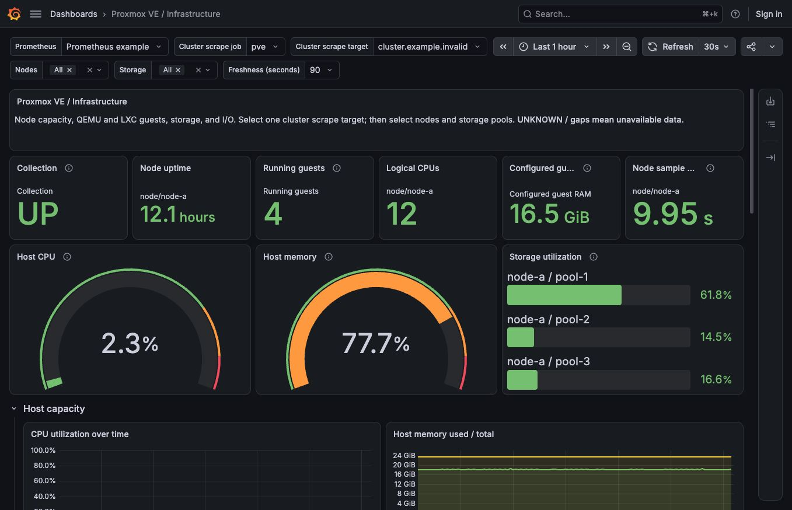
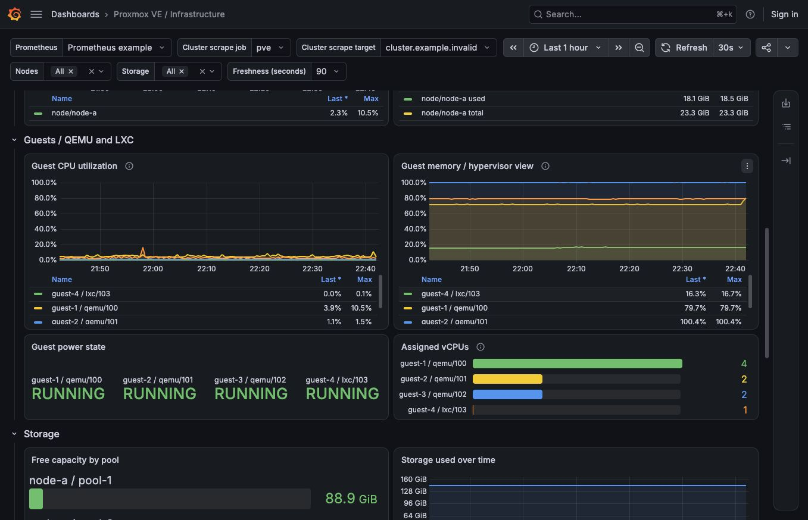

# Proxmox VE / Infrastructure dashboard

A portable Grafana dashboard for prometheus-pve-exporter: node capacity, QEMU and LXC guests, storage pools, and guest network/disk rates. Uses native panels only.



## Import

1. Configure prometheus-pve-exporter and a Prometheus scrape job using the exporter README. This dashboard does not install an exporter or create API credentials.
2. Add that Prometheus server as a Grafana data source. Set its scrape interval to match Prometheus; the live validation used 30 seconds.
3. In Grafana, choose **Dashboards → New → Import**, upload `proxmox-infrastructure.json`, and import it.
4. Select **Prometheus**, **Cluster scrape job**, and exactly one **Cluster scrape target**. Choose **Nodes** and **Storage**, or leave them at **All**.
5. Set **Freshness (seconds)** above your scrape interval plus scrape duration and expected jitter. The 90-second default was tested with a 30-second scrape interval and 20-second timeout. For a 60-second interval, consider 180 seconds.

No environment-specific data-source UID, IP address, hostname, storage name, or timezone is embedded. Data-source selection uses a Grafana data-source variable, so there is no separate import-time data-source mapping dialog. Save your own dashboard copy to retain selections.

## Collection and cluster scope

Required collectors: `status`, `node`, and `resources`, with cluster collection enabled (`cluster=1`). Required metrics include `pve_node_info`, `pve_guest_info`, `pve_storage_info`, `pve_up`, CPU, memory, storage, uptime, and the current I/O `_total` counters. Optional subscription, configuration, backup, and replication collectors are not used.

For these panels, collect cluster metrics from **one endpoint per cluster**, as described in the exporter's large-cluster guidance. One endpoint returns the cluster's nodes, guests, and storage entries; the dashboard's node selector filters those entries. Additional per-node jobs can collect node-only metrics using `cluster=0&node=1`, but are not the job selected here.

For an exporter reachable from the Prometheus host, the following is an illustrative cluster job. Replace the example DNS names, and use an existing exporter configuration module:

```yaml
scrape_configs:
  - job_name: pve-cluster
    scrape_interval: 30s
    scrape_timeout: 20s
    metrics_path: /pve
    params:
      module: [default]
      cluster: ['1']
      node: ['0']
    static_configs:
      - targets: ['pve-api.example.invalid']
    relabel_configs:
      - source_labels: [__address__]
        target_label: __param_target
      - source_labels: [__param_target]
        target_label: instance
      - target_label: __address__
        replacement: pve-exporter.example.invalid:9221
```

The dashboard selects one scrape `instance` at a time and joins on `job,instance,id`. It does not sum duplicate cluster scrapes. It also does not deduplicate HA Prometheus replicas or multiple endpoints relabelled to the same instance; resolve that in the collection/query layer. A single cluster scrape endpoint creates a collection dependency: its failure leaves the view unavailable even if other cluster nodes remain healthy.

## Interpretation

- CPU ratios are already relative to the node's or guest's CPU capacity. Do not divide them by the CPU count again.
- Running guests includes QEMU and LXC, excluding templates. Stopped guests remain visible in the power-state panel. Configured guest RAM includes stopped guests.
- Guest memory is Proxmox's view, not guest OS available memory. Accounting estimates can occasionally exceed configured memory; the dashboard does not rewrite those values.
- Storage entries can share underlying disks. Do not add them together as independent physical capacity. Backup-storage capacity does not establish backup freshness or restore success.
- Network and disk rates use `rate(...[$__rate_interval])` with current counter names. They require at least two samples; availability depends on guest/storage support.
- Instant panels are gated on a successful recent Prometheus scrape. A failed scrape shows **FAILED** on Collection and suppresses other instant values; old/missing scrapes show **UNKNOWN**. Missing data is not replaced with zero. Healthy collection does not prove every optional metric or application is healthy.
- Historical queries evaluate scrape health at each point in time. A failed current scrape does not erase earlier healthy history; legend statistics can still describe earlier samples.
- Node sample age is the age of a Prometheus sample, not Proxmox's internal observation time.

## Validation

Tested with Proxmox VE 9.2.21, prometheus-pve-exporter 3.10.1, Prometheus/promtool 3.15.0, and Grafana 13.2.1. Other versions have not been verified. The dashboard uses schema version 39; no claim of an older minimum Grafana version is made.

All 22 queries returned series against a live single-node deployment with three QEMU VMs, one LXC, and three storage entries. Browser checks used a disposable Grafana instance and a preview-only proxy that anonymized infrastructure labels. Production Grafana configuration and authentication were not changed.

`query-tests.json` contains synthetic PromQL tests for multiple nodes, mixed QEMU/LXC, template exclusion, job/target isolation, failed/stale scrapes, and a stopped LXC:

```sh
promtool test rules query-tests.json
```

JSON is accepted by the YAML parser used by promtool. These fixtures do not constitute a real multi-node cluster test. Real cluster testing and additional Grafana-version feedback are welcome.



## Development and attribution

Regenerate the dashboard with `python3 build.py`. The builder uses only the Python standard library.

This native-panel layout grew out of a working home-lab dashboard. Its exporter metric model was informed by [Proxmox via Prometheus by Pietro Saccardi/mittelab](https://github.com/mittelab/proxmox-via-prometheus-dashboard); the companion upstream JSON is not included. This contribution is offered under the exporter's Apache-2.0 license. It is not an official Proxmox dashboard.

Related request: [prometheus-pve-exporter #395](https://github.com/prometheus-pve/prometheus-pve-exporter/issues/395).
